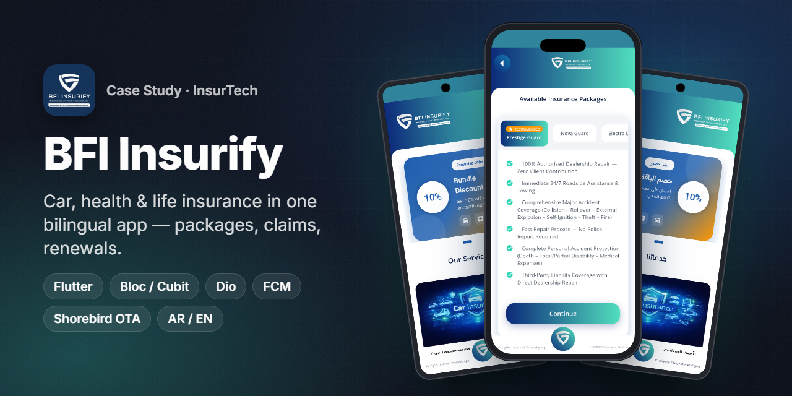
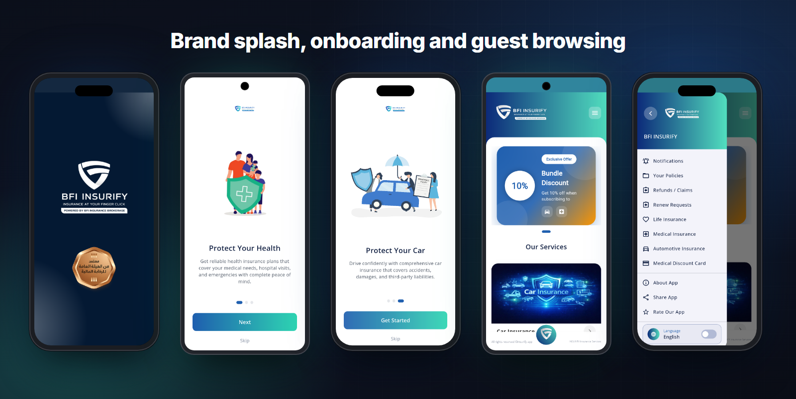
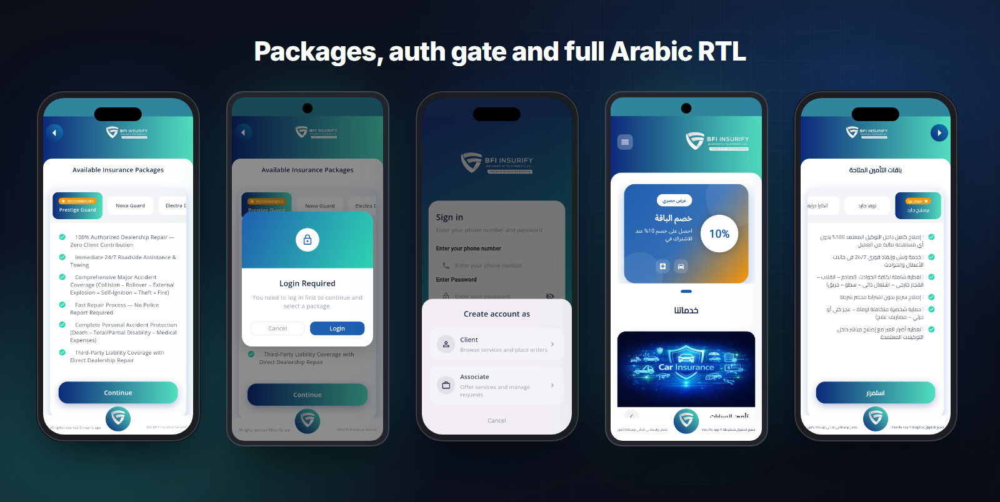
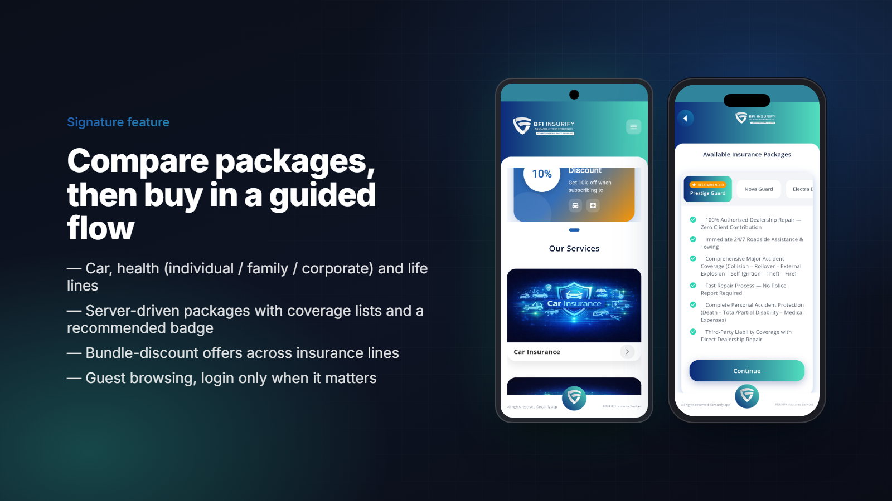
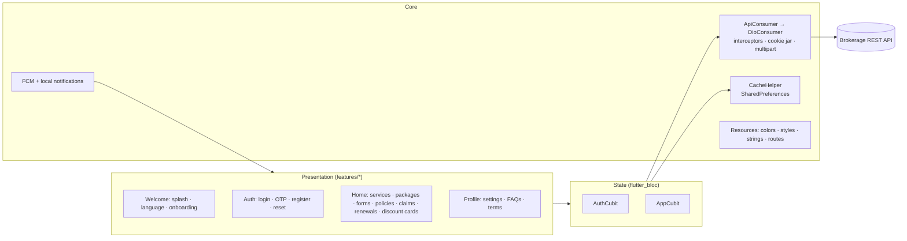

<h1 align="center">BFI Insurify</h1>

<b>Car, health and life insurance in one bilingual Flutter app: compare packages, buy a policy, file a claim, renew. All from the phone.</b>

  
  
  
  
  
  
  

> ℹ️ Case study. The source code belongs to the client and is not included.

## Overview
**BFI Insurify** ("Insurance at your finger click") is the customer app of an Egyptian insurance brokerage. Customers can browse insurance products as guests, compare packages from partner insurers and submit a full insurance request with their documents. After that, the same app handles the whole policy lifecycle: activation, payment status, claims/refunds, renewals and a medical discount card.

- **Market:** Egypt. Arabic (ar-EG) and English (en-US), with a full RTL layout.
- **My role:** Flutter developer for the mobile app. I built the UI, state management, API integration, push notifications and the release pipeline, including Shorebird code push.
- **Distribution:** Delivered to the client. It is not on a public store listing at the time of writing.

## The challenge
- Insurance is form-heavy. Each product line (car, individual/family/corporate health, life) asks for different data and documents. All of them still had to feel like one simple flow.
- Customers should be able to explore offers **without an account** and only be asked to log in when they commit to a package.
- After purchase, a policy goes through several states: pending payment, pending activation, active and expired, plus claims and renewals. The customer needs to see clearly where each policy stands.
- Fixes had to reach users quickly without waiting for store review.

## Highlights
**🛡️ Products & offers**
- Car insurance with a make → model → year catalog and car value / coverage percentage.
- Health insurance for **individuals, families** (member list) and **corporates** (minimum 10 employees), plus life insurance with insured amount and duration.
- Server-driven **packages** with coverage bullet lists and "Recommended / Best value" badges, plus a company-offers comparison.
- **Bundle discount** offers: a percentage off when subscribing to more than one line, such as car + health.

**📄 Policy lifecycle**
- "My Policies" with status chips: Active, Pending payment, Pending activation, Expired.
- Policy activation with a payment key, payment-status updates, and **renewal requests** with their own tracking.
- **Claims / refunds**: upload accident description, ID, car licence and driving licence. Status moves through Submitted → Review → Completed / Rejected.
- **Medical discount card**: choose a plan, request a card, activate it with an activation key.

**👤 Account & UX**
- Phone + password login, OTP verification, forgot/reset password, profile completion, account deletion.
- Guest mode with a friendly "Login required" gate. The account type is Client or Associate.
- In-app notifications center (mark one / all as seen) and FCM push.
- Light/dark theme, adjustable font scale, and a language switch at runtime.

## Screens
Real screenshots, captured from the app's own UI running as a Flutter web build in guest mode.

Brand splash · onboarding (health / car) · guest home with bundle offer and services · navigation drawer

Package comparison · login-required gate · sign in / account type · home and packages in Arabic (RTL)

## Signature feature

**Compare, choose, then request.** Each service card on the home screen (car, medical, life) opens the packages available for that line. Package names, coverage bullets and the recommended badge all come from the API, so the business can change offers without an app release. Choosing a package runs a guided request:

1. **Pick a package.** As a guest you can browse everything. Login is requested only at this step.
2. **Fill the product form**: car data from the make/model/year catalog, health members, or the life insured amount.
3. **Personal data + documents.** National ID, licences and a photo are uploaded as multipart form data.
4. **Submit.** A success screen gives the expected processing time, and the request then appears under *My Policies* to be tracked through activation and payment.

If a bundle offer is active, the selected plans for each line are kept together so the discount is applied across car and health in a single request.

## Architecture & stack

| Layer | Tech |
|---|---|
| UI | Flutter, `flutter_screenutil`, `flutter_svg`, `carousel_slider`, `shimmer`, `cached_network_image` |
| State management | `flutter_bloc` / Cubit (`AuthCubit`, `AppCubit`) + `equatable`, global `BlocObserver` |
| Networking | `dio` behind an `ApiConsumer` abstraction, interceptors, `cookie_jar` + `dio_cookie_manager`, multipart uploads |
| Persistence | `shared_preferences` (session, theme, language, onboarding flags) |
| Localization | `easy_localization` with JSON bundles (ar-EG / en-US), Cairo + Open Sans fonts |
| Notifications | `firebase_core`, `firebase_messaging`, `flutter_local_notifications` |
| Device | `image_picker`, `permission_handler`, `url_launcher`, `share_plus` |
| Delivery | Shorebird code push (OTA patches), `flutter_launcher_icons` |

## Engineering notes
- **Session committed only after OTP.** On login, the access/refresh tokens are held as *pending* and are written to storage only after OTP verification succeeds. A half-verified user never ends up with a persisted session. On launch, the splash screen silently refreshes the token. If that fails, it clears the session and drops the user into guest mode instead of blocking them.
- **FCM token before the first screen.** Notification setup runs before `runApp` (wrapped in a try/catch), so the device token already exists when the user reaches login and is sent with it. If Firebase isn't configured, the app still starts. On iOS, the APNs token is awaited before asking for the FCM token.
- **Guest-first navigation.** Home, services and packages work without auth. A reusable `LoginRequiredDialog` guards only the actions that need an account. This keeps the entry funnel short.
- **Tablet-safe layout.** The app was designed for phones. On tablets, a `MediaQuery` override pins a phone-sized logical canvas and a fixed text scale, so forms and cards never stretch or break.
- **One request model for many products.** An `InsuranceRequestContext` carries the selected line, package and bundle plan through the multi-step forms. Car, health-individual, health-group and life documents all use the same submission pipeline.
- **OTA hotfixes.** Shorebird is integrated, so Dart-level fixes can be shipped as patches without a new store build.

## Results
- One app covering **3 insurance lines** (car, health, life) and the full policy lifecycle: purchase, activation, claims, renewal and discount cards.
- Fully bilingual (**Arabic RTL + English**) with light/dark themes.
- Delivered to the client. No public store listing is available to cite.

## بالعربي
**BFI Insurify** تطبيق تأمين لعملاء وسيط تأمين في مصر. العميل يتصفح باقات تأمين السيارات والطبي والحياة كضيف، ويقارن الباقات ويختار، وبعدها يقدّم الطلب مع مستنداته.
بعد الشراء، التطبيق يتابع الوثيقة في كل مراحلها: التفعيل والدفع والتجديد والمطالبات/الاستردادات وكارت الخصم الطبي.
اتبنى بـ Flutter وBloc/Cubit وDio، وفيه إشعارات FCM وتحديثات فورية من غير المتجر عن طريق Shorebird.
التطبيق بالعربي والإنجليزي، يدعم RTL بالكامل، وفيه وضع ليلي وتكبير خط.

## Links
- Not publicly listed on the stores. Screens above are real UI captures.
- More of my work: [Portfolio](https://anashaker.github.io/shaker_portfolio/)

---
<h3 align="center">Built by Mahmoud Shaker — Senior Flutter Engineer</h3>

  
  
  
  
  
  
  

